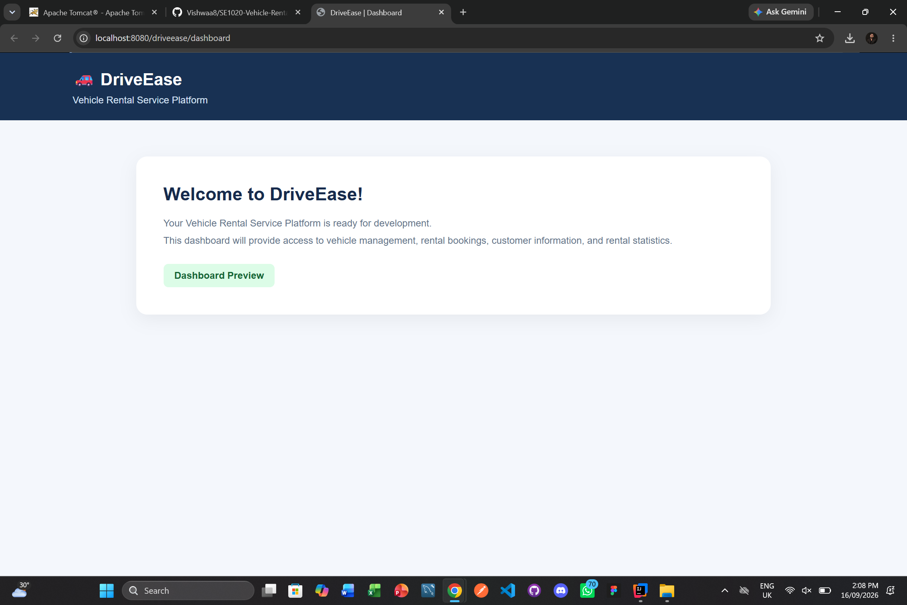

# 🚗 DriveEase
### Vehicle Rental Service Platform

**SE1020 – Object Oriented Programming | Individual Project**

DriveEase is a Java-based web application for managing rental vehicles and customer bookings. It provides vehicle and booking CRUD operations, search functionality, rental cost calculation, booking conflict prevention, and a responsive dashboard.

The application is built using **Java, JSP, Jakarta Servlets, and Object-Oriented Programming (OOP) principles**. Vehicle and booking records are stored in text files using Java file handling.

---

## 📌 Project Overview

Vehicle rental operations require a way to maintain vehicle information, record customer reservations, and prevent conflicting bookings.

DriveEase brings these operations together in a web application. Users can maintain vehicle records, create and manage bookings, search stored information, and view summary statistics on the dashboard.

### Project Objectives

- Develop a functional Java web application.
- Apply OOP principles through a structured class design.
- Implement Create, Read, Update, and Delete (CRUD) operations.
- Persist vehicle and booking records using Java file handling.
- Validate booking information and prevent overlapping reservations.
- Provide a responsive interface with persistent light and dark themes.
- Track development using Git and GitHub.

---

## ✨ Implemented Features

### 🚘 Vehicle Management

- [x] Add new vehicles.
- [x] View vehicle records.
- [x] Search vehicles by ID and vehicle details.
- [x] Update vehicle information.
- [x] Delete vehicles that have no associated bookings.
- [x] Prevent deletion of a vehicle with existing bookings.
- [x] Manage vehicle availability.
- [x] Support `Car`, `Van`, and `Bike` vehicle types.

**Delete protection:** If a vehicle has an existing booking, its deletion request is rejected with **HTTP 409 Conflict**. The vehicle and its booking remain stored. The booking must be deleted before the vehicle can be removed.

### 📅 Rental Booking Management

- [x] Create rental bookings.
- [x] View and search existing bookings.
- [x] Update booking information.
- [x] Delete bookings.
- [x] Validate booking dates.
- [x] Reject overlapping bookings for the same vehicle.
- [x] Allow adjacent bookings when a new booking starts on the previous booking's return date.
- [x] Reject bookings for unavailable or nonexistent vehicles.
- [x] Reject duplicate booking IDs.

### 👤 Customer Information

- [x] Capture a customer's name and phone number during booking.
- [x] Associate customer details with each booking.
- [x] Display customer information in booking records.

Customer information is stored **within booking records**. The application does not use a separate customer management module or `customers.txt` file.

### 💰 Rental Cost Calculation

- [x] Calculate rental duration.
- [x] Calculate total rental cost using the vehicle's daily rate.
- [x] Store the applicable daily rate with each booking.

**Rental calculation:** The pickup date is included, and the return date is not counted as a rental day. For example, a booking from September 20 to September 23 covers **3 rental days**.

### 📊 Dashboard

- [x] Display total vehicle records.
- [x] Display vehicles marked available and unavailable.
- [x] Display total booking records.
- [x] Display the number of distinct vehicles with bookings.
- [x] Display the calculated total booking value.
- [x] Provide navigation to vehicle and booking management.

The **total booking value** represents the calculated value of saved bookings; it is not a payment collection or revenue-tracking feature.

### 🎨 User Interface

- [x] Responsive layouts for desktop and mobile screen sizes.
- [x] Vehicle and booking management forms.
- [x] Light and dark modes.
- [x] Theme preference retained across page navigation and browser refreshes.
- [x] Scrollable tables on smaller screens.

---

## 🛠️ Technology Stack

### Backend

| Technology | Purpose |
|------------|---------|
| Java | Models, services, validation, and business logic |
| JSP | Dynamic web pages |
| Jakarta Servlets | HTTP request handling |
| Java File I/O | Text-file persistence |
| Maven | Project build and WAR packaging |

### Frontend

| Technology | Purpose |
|------------|---------|
| HTML5 | Page structure |
| CSS3 | Styling and responsive layouts |
| JavaScript | Client-side interactions and theme switching |

### Development Environment

| Component | Version / Configuration |
|-----------|-------------------------|
| IDE | IntelliJ IDEA 2026.2.2 |
| Development JDK | Java 23.0.2 |
| Java compilation target | Java 21 |
| Application server | Apache Tomcat 10.1.60 |
| Build tool | Apache Maven |
| Application context | `/driveease` |
| Version control | Git and GitHub |

**Data storage:** Java text files (`vehicles.txt` and `bookings.txt`). The application does not require a relational database.

---

## 🧩 Object-Oriented Programming Concepts

DriveEase uses OOP concepts to organize its models and application logic.

### 1. Encapsulation

The `Vehicle` and `Booking` models maintain their data through class attributes and methods. Vehicle management and booking management logic are organized in dedicated service classes.

### 2. Inheritance

`Vehicle` is an abstract superclass, and the application includes three specialized vehicle types:

```text
             Vehicle
          (abstract class)
                 |
       +---------+---------+
       |         |         |
      Car       Van       Bike
```

### 3. Polymorphism

The application handles `Car`, `Van`, and `Bike` objects through the common `Vehicle` type. This allows vehicle management and file-handling operations to work with different vehicle subclasses.

### 4. Abstraction

The abstract `Vehicle` class represents the common properties and behavior of rental vehicles while its subclasses represent specific vehicle types.

### 5. Information Hiding

Classes use Java access modifiers to control access to their internal state and implementation details.

---

## 🔄 CRUD Operations

| Operation | Vehicle Management | Booking Management |
|-----------|-------------------|--------------------|
| Create | Add a vehicle | Create a booking |
| Read | View and search vehicles | View and search bookings |
| Update | Edit vehicle details | Modify booking details |
| Delete | Remove a vehicle without bookings | Delete a booking |

CRUD operations are handled by Java service classes, with records loaded from and saved to text files.

---

## 🗂️ Data Storage

DriveEase stores data in two text files:

```text
DriveEase/
└── data/
    ├── vehicles.txt
    └── bookings.txt
```

**Note:** This is the application's data directory under the operating system user's home directory, not a `data/` folder inside the Git repository.

The file-handling classes are:

- `VehicleFileHandler` — saves and loads vehicle records.
- `BookingFileHandler` — saves and loads booking records.

The application supports reading, writing, updating, and deleting stored records. Data persistence was verified by restarting Tomcat and confirming that the saved vehicle and booking records were still available.

Customer details are stored in `bookings.txt` as part of each booking record.

---

## 🖥️ Application Pages

| Page | Description |
|------|-------------|
| Dashboard | Vehicle and booking overview |
| Vehicles | View, search, and manage vehicles |
| Add/Edit Vehicle | Create and update vehicle records |
| Bookings | View, search, and manage bookings |
| Add/Edit Booking | Create and update rental bookings |

The application includes consistent navigation and responsive styling across these pages.

---

## 🔁 Booking Workflow

```text
Open Bookings
      |
      v
Create New Booking
      |
      v
Select an Available Vehicle
      |
      v
Enter Customer Details
      |
      v
Select Pickup and Return Dates
      |
      v
Validate Vehicle and Dates
      |
      +---- Conflict / Invalid Data ----> Reject Booking
      |
      v
Calculate Rental Cost
      |
      v
Save Booking to Text File
      |
      v
View / Search / Update / Delete Booking
```

---

## 📁 Project Structure

```text
SE1020-Vehicle-Rental-Service-Platform/
│
├── src/
│   ├── main/
│   │   ├── java/
│   │   │   └── com/driveease/
│   │   │       ├── model/
│   │   │       │   ├── Vehicle.java
│   │   │       │   ├── Car.java
│   │   │       │   ├── Van.java
│   │   │       │   ├── Bike.java
│   │   │       │   └── Booking.java
│   │   │       │
│   │   │       ├── servlet/
│   │   │       │   ├── DashboardServlet.java
│   │   │       │   ├── VehicleServlet.java
│   │   │       │   └── BookingServlet.java
│   │   │       │
│   │   │       ├── service/
│   │   │       │   ├── VehicleService.java
│   │   │       │   └── BookingService.java
│   │   │       │
│   │   │       └── util/
│   │   │           ├── VehicleFileHandler.java
│   │   │           └── BookingFileHandler.java
│   │   │
│   │   └── webapp/
│   │       ├── WEB-INF/
│   │       │   └── views/
│   │       │       ├── dashboard.jsp
│   │       │       ├── vehicles.jsp
│   │       │       ├── vehicle-form.jsp
│   │       │       ├── bookings.jsp
│   │       │       └── booking-form.jsp
│   │       │
│   │       ├── css/
│   │       │   ├── vehicles.css
│   │       │   ├── bookings.css
│   │       │   └── theme.css
│   │       │
│   │       └── js/
│   │           └── theme.js
│   │
│   └── test/
│       └── java/com/driveease/
│           ├── service/
│           │   ├── VehicleServiceTest.java
│           │   ├── BookingServiceTest.java
│           │   └── VehicleDeleteProtectionTest.java
│           │
│           └── util/
│               ├── VehicleFileHandlerTest.java
│               └── BookingFileHandlerTest.java
│
├── docs/
│   └── screenshots/
│
├── .gitignore
├── pom.xml
└── README.md
```

**Note:** Runtime data files are stored separately from the Git repository. Maven-generated files are created in `target/`.

---

## ⚙️ Installation and Setup

### Requirements

- JDK 21 or later, compatible with the project's Java 21 compilation target.
- Apache Maven.
- Apache Tomcat 10.1.
- IntelliJ IDEA or another Java IDE with Maven and Tomcat support.

### Running the Application in IntelliJ IDEA

1. Clone the repository:

   ```bash
   git clone https://github.com/Vishwaa8/SE1020-Vehicle-Rental-Service-Platform.git
   ```

2. Open the cloned project in IntelliJ IDEA.
3. Allow Maven to download and resolve the project dependencies.
4. Configure an Apache Tomcat 10.1 server.
5. Add the `driveease:war exploded` deployment artifact.
6. Set the application context to `/driveease`.
7. Start Tomcat.

Open the application at:

**http://localhost:8080/driveease/dashboard**

### Building the WAR File

Run the following command from the project root:

```bash
mvn package
```

A successful build produces:

```text
target/driveease.war
```

The final Maven package build was completed successfully on **September 17, 2026**.

---

## 🚀 Deployment Verification

DriveEase was successfully deployed locally using **Apache Tomcat 10.1.60**.

The following were verified:

- Maven compilation and WAR packaging.
- Tomcat server startup.
- Deployment of the `driveease:war exploded` artifact.
- Servlet request handling.
- JSP rendering in the browser.
- Vehicle and booking data persistence across a Tomcat restart.

### Initial Deployment Screenshot



*Figure 1: Initial DriveEase dashboard during local deployment.*

**Note:** This screenshot documents the initial deployment. The completed interface includes vehicle management, booking management, dashboard statistics, and light/dark themes.

---

## 🧪 Testing and Verification

Testing was performed through standalone Java test programs in IntelliJ IDEA and manual browser-based verification.

### Standalone Java Tests

| Test Class | Checks Passed |
|------------|--------------:|
| `VehicleServiceTest` | 8 / 8 |
| `BookingServiceTest` | 13 / 13 |
| `VehicleDeleteProtectionTest` | 3 / 3 |
| `VehicleFileHandlerTest` | 5 / 5 |
| `BookingFileHandlerTest` | 6 / 6 |
| **Total** | **35 / 35** |

All five test programs were run individually in IntelliJ IDEA and finished with **exit code 0**.

The tests cover vehicle and booking CRUD operations, searches, persistence, duplicate-ID handling, booking overlap validation, unavailable and missing vehicles, rental calculations, file handling, and vehicle deletion protection.

The test programs use temporary files to avoid modifying the application's saved vehicle and booking records.

**Important:** These are `main()`-based test programs rather than JUnit tests. Maven Surefire reports `Tests run: 0` during `mvn package` because it does not automatically execute these standalone programs. The **35 / 35** result refers to the programs run individually in IntelliJ IDEA, not to a Maven test run.

### Browser Verification

The following behavior was verified in the running application:

- Vehicle and booking records remained available after a Tomcat restart.
- Deleting a vehicle with an existing booking returned **HTTP 409 Conflict**.
- The vehicle and its booking remained stored after the rejected deletion.
- Deleting the booking first allowed its vehicle to be deleted afterward.
- Temporary verification records were successfully removed.
- Dashboard vehicle and booking counts matched the saved records.
- Vehicle and booking searches returned the matching records.
- Searches worked with lowercase search input.
- Light and dark theme preferences persisted across page navigation and refreshes.
- Responsive layouts were checked at a mobile viewport size of **390 × 844**.

### Final Build

The final Maven package command completed with:

```text
BUILD SUCCESS
```

The generated WAR file is located at `target/driveease.war`.

---

## 📚 Project Documentation

The project documentation includes this README and the initial deployment screenshot.

The following submission documents are **being prepared**:

- UML class diagram.
- Final project report.
- Final screenshots and supporting evidence.

These items will be marked complete after they have been prepared and reviewed.

---

## 📈 Development Progress

| Phase | Status |
|-------|--------|
| Project planning | Completed |
| Repository setup | Completed |
| Maven and Java project setup | Completed |
| OOP model implementation | Completed |
| File handling | Completed |
| Vehicle and booking CRUD | Completed |
| Frontend development | Completed |
| Functional and regression verification | Completed |
| Final Maven build | Completed |
| UML class diagram | In Progress |
| Final project report | Not Started |
| Viva preparation | Not Started |

---

## 👨‍💻 Developer

**Vishwa Udhantha Muthukudaarachchi**

BSc (Hons) in Information Technology  
Faculty of Computing  
Sri Lanka Institute of Information Technology (SLIIT)

**Module:** SE1020 – Object Oriented Programming  
**Project Type:** Individual Project

---

## 🎓 Academic Project

DriveEase was developed as an individual project for the **SE1020 Object Oriented Programming** module at SLIIT.

The project demonstrates Java programming, object-oriented design, CRUD operations, file handling, validation, and web application development.

---

### 🚗 DriveEase

**Your Journey, Our Wheels.**

*SE1020 – Object Oriented Programming*